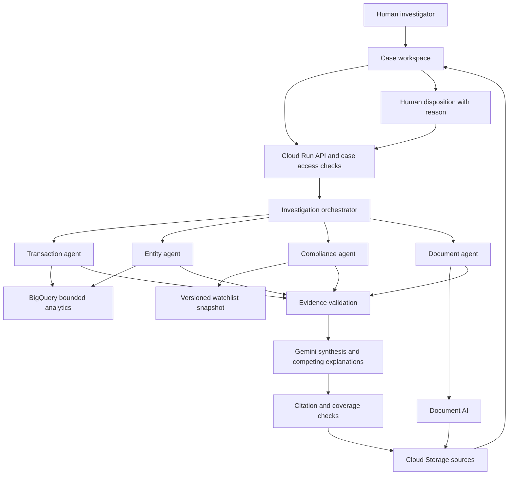

# System and multi-agent architecture

Architecture baseline, 2026-10-09. A single-service prototype is implemented.
The diagram includes design responsibilities rather than asserting every proposed
tool exists. Implemented source/catalog, follow-up, recovery and Q&A boundaries
are documented in [investigator workspace](investigator-workspace.md).
Current measured state is in [project context](project-context.md).

## System boundary

One Cloud Run service contains the API, bounded ADK investigation runtime,
deterministic tools and built React/TypeScript UI. BigQuery holds source
snapshots; Cloud Storage holds documents and versioned case artifacts. Gemini
and Document AI are invoked server-side using a narrowly scoped service account.

Agents are distinct domain roles within one runtime, not independently deployed
services. Runtime policy controls tools, deadlines, retries and state transitions.

## Agent responsibilities

| Role | Allowed tools | Output and boundary |
|---|---|---|
| Orchestrator | Case inventory, evidence lookup, domain delegation, hypothesis verification | Structured plan with evidence needed and selected specialists; synthesizes the final draft. Cannot approve a case. |
| Transaction Investigation | `get_transactions`, `trace_flows`, `detect_cycles`, `detect_structuring`, `summarize_activity` | Typed numeric indicators and candidate paths with transaction IDs. Interpretation can suggest layering; calculations cannot be delegated to text generation. |
| Entity Intelligence | `resolve_candidates`, `get_relationships`, `trace_ownership` | Candidate identities, source-backed edges, bounded ownership paths and missing-link notes. Fuzzy names alone cannot merge entities. |
| Compliance Screening | `screen_candidates`, `compare_identifiers`, `get_watchlist_record` | Separate sanctions/PEP candidates, supporting/conflicting attributes and unresolved fields. No name-only automatic clearance or confirmation. |
| Document Intelligence | `extract_document`, `normalize_fields`, `compare_fields` | Document type, extracted fields and page anchors, normalization history and inconsistencies. Cannot declare a document genuine or forged from extraction alone. |

Each specialist uses Gemini where interpretation is needed and tools where facts
must be obtained. Shared prompts require evidence IDs, missing-data statements
and alternative explanations. Reuse typed schemas and validators across roles.
Log concise plans and tool events, not private chain-of-thought.

## Investigation workflow

1. Validate case manifest, provenance, supported inputs and access. Resolve the
   case to a pinned snapshot. Do not expose ground truth to any agent.
2. Orchestrator proposes the investigation steps from case inputs. A policy
   validator checks tool allowlists and required domain coverage; route to
   relevant specialists. Scenario labels are evaluation metadata, not hints.
3. Run document extraction before comparisons that need document fields.
   Transaction and independent entity/screening work may then run concurrently
   with bounded concurrency; specialists cannot mutate shared evidence records.
4. Validate every tool result, save source and derived evidence, and deduplicate
   references. Preserve contradictions instead of forcing a single narrative.
5. Orchestrator proposes hypotheses and requests a bounded verification pass.
   A hypothesis can become supported only through source-backed checks; a second
   model agreeing with it is not verification.
6. Generate structured report claims, evidence links and a review priority using
   configured indicator rules. Check evidence membership and numeric claims.
   Reject unsupported claims; permit one repair pass, then record failure or gaps.
7. Persist an immutable report version. Stop the run at `awaiting_review`.
   A human action creates a separate disposition referencing that version.

## Runtime limits and persistence

Initial proposed limits: one active run per demo session, five specialists
including the orchestrator, at most 20 tool calls, two attempts for transient
provider errors, and 120 seconds per run. Apply per-step timeouts within that
deadline. No unbounded delegation or automatic re-investigation loop.

Execute within an active HTTP request and stream progress when practical. A
reconnecting browser reads saved run events; it does not silently start again.
Do not launch unmanaged background work after returning HTTP 202. If reliable
long jobs become necessary, implement a durable worker before changing this rule.

Persist each completed step under `cases/{case_id}/runs/{run_id}/`. Store the
current run manifest with Cloud Storage generation-match preconditions. An
idempotency key binds case, input hash and run request; duplicate requests return
the existing run. A stale `running` manifest becomes `interrupted` after its
deadline; continuation is an explicit new attempt with checkpoint references.
Cloud Run instance memory and local SQLite are not durable source-of-truth stores.

Prototype audit artifacts are versioned and application-append-only. This is
traceability, not a certified tamper-proof audit system. Never overwrite an
approved report; changed inputs require a new run and new review.

## Tools and risk interpretation

All tools receive server-resolved case scope. Parameterized query templates
allow timestamps/accounts/limits, not unrestricted model-generated SQL. Evidence
rows are capped and paginated, with truncation explicitly reported.

Flow paths must be directed and time-respecting. A path does not prove the same
funds moved through all edges: commingling, fees and FX constrain attribution.
Cycle detection has depth/time/result caps. Structuring uses explicit demo
thresholds and windows, never an unstated regulatory threshold. Anomalies use
explainable features against adequate peer/history data; sparse samples return
insufficient baseline. Network findings reference shared accounts, timing or
ownership evidence rather than an unexplained risk score.

Review priority is a transparent rule result (`low`, `medium`, `high`, or
`insufficient_evidence`) with contributing indicators and policy version.
It is not a probability of crime. Sanctions and PEP status are separate concepts.

## Prototype security and operational route

Public judges can access preloaded synthetic cases only. Disable arbitrary
uploads and external URL fetching in the public demo; later upload workflows
need authentication, content/size controls and scoped object access. Give each
visitor a scoped session, with server-side access checks for runs/reviews and
bounded per-session plus global workload quotas.

Use service-account identity, private Storage objects and API-mediated evidence
access. Never put provider credentials in the frontend or repository. Treat
document text as untrusted data; it cannot change system instructions, invoke
unapproved tools or widen case scope. Do not log complete document contents.

Prefer Singapore (`asia-southeast1`) for supported services, but verify exact
Gemini model and Document AI processor/version availability before setup. A
global model endpoint is a separately documented choice, not a residency claim.
Record the chosen project/region, deployment revision, log query and rollback
route after deployment is authorized and verified.

Later enterprise work adds authenticated tenant isolation, relational workflow
state, durable workers, source refresh policies and retention controls. These
need separate validation; the prototype does not establish enterprise readiness.
